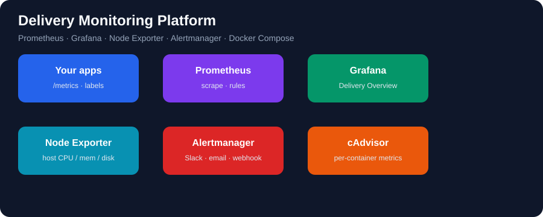
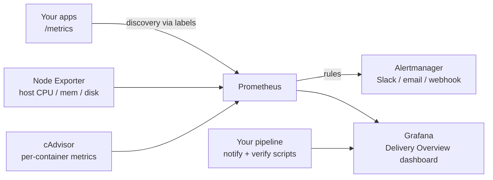

<div align="center">

# 📊 Delivery Monitoring Platform

**See every deploy. Catch every failure. Before your users do.**


*Prometheus · Grafana · Node Exporter · Alertmanager · Docker Compose (+ cAdvisor)*

</div>

---

## 🎯 What this does

Every time your pipeline deploys an application, this platform shows its **health, resource consumption, uptime and failures** — with **no per-app monitoring config**.

> **The only contract:** your container joins the `monitoring` network and carries a few labels. It is discovered within ~15 seconds. No Prometheus edits, no restart.

## 🖼️ Architecture





| Service | URL | What it is |
|---|---|---|
| **Grafana** | http://localhost:3000 | Dashboards — open on the **Delivery Overview** dashboard (folder *Delivery*) |
| **Prometheus** | http://localhost:9090 | Metrics + alert rules |
| **Alertmanager** | http://localhost:9093 | Alert routing, grouping and silences |

📸 **Screenshots:** the architecture diagram above is the visual reference for this repo. A real Grafana screenshot can be added later from a live run — save it as `docs/screenshots/grafana-overview.png` and it will show here. No fake screenshots are included.

## 🚀 Quick start

```bash
cp .env.example .env          # set GRAFANA_ADMIN_PASSWORD
docker compose up -d
./scripts/smoke-test.sh       # checks prometheus / alertmanager / grafana + target health
```

Ports bind to `127.0.0.1` by default. Set `BIND_ADDR=0.0.0.0` in `.env` only behind a firewall / reverse proxy.

## 🔌 Connect an application

Any container that **joins the `monitoring` network** and carries these **labels** is discovered within ~15 seconds.

```yaml
services:
  my-app:
    image: registry.example.com/my-app:${APP_VERSION}
    labels:
      monitoring.scrape: "true"
      monitoring.port: "8080"          # port serving metrics
      monitoring.path: "/metrics"      # optional, default /metrics
      monitoring.app: "my-app"         # name shown in Grafana / alerts
      monitoring.env: "production"
      monitoring.version: "${APP_VERSION}"   # lets you see which release is running
    networks: [monitoring]

networks:
  monitoring:
    external: true
```

Try it with the bundled stand-in app:

```bash
docker compose -f example-app/docker-compose.yml up -d
```

Apps outside Docker: add them to `prometheus/targets/apps.yml` (hot-reloaded).

Your app needs a Prometheus `/metrics` endpoint for the *health + error-rate* signals (client libraries exist for Node, Python, Go, Java, .NET...). If it exposes `http_requests_total{code="..."}` you also get request rate and 5xx ratio. Container CPU / memory / network / restarts come from cAdvisor and work **even for apps with no metrics endpoint** (just add the `monitoring.app` label).

## 🔁 Hook it into the pipeline

Copy `scripts/` into your repo (or call them from a checkout of this one). Three touch points:

| Step | Script | What it does |
|---|---|---|
| Before deploy | `scripts/notify-deploy.sh` | Adds a blue **Deployments** marker to Grafana (app, version, commit, pipeline link). `--silence-minutes 5` mutes that app's alerts during the rollout. |
| Deploy | *your existing step* | Must start the container with the labels above. |
| After deploy | `scripts/verify-deploy.sh` | Waits for `up == 1`, soaks 30 s, fails the job on crash-loop or >5 % 5xx. |

Ready-to-paste examples: `ci-examples/github-actions.yml`, `gitlab-ci.yml`, `Jenkinsfile`.

Pipeline secrets needed: `GRAFANA_URL`, `GRAFANA_TOKEN` (Grafana → Administration → Service accounts → Editor role), `ALERTMANAGER_URL`, `PROMETHEUS_URL`. If the pipeline runs on GitHub-hosted runners it cannot reach a localhost-bound server — run the scripts over SSH on the deploy host, use a self-hosted runner, or publish the ports through a reverse proxy with auth.

## 📈 What you get

**Dashboard (`Delivery Overview`, filter by `app`):** apps up/down · firing alerts · restarts (1 h) · 24 h uptime % · per-app status table · up/down timeline · request rate · 5xx ratio · container restarts · CPU · memory · network · container age (resets on every deploy) · host CPU / memory / disk / load · deploy markers on every graph.

**Alerts (`prometheus/rules/alerts.yml`):**

| Alert | Fires when | Severity |
|---|---|---|
| AppDown | target unreachable 1 min | critical |
| HighErrorRate | 5xx > 5 % for 5 min | critical |
| ContainerCrashLoop | >2 restarts in 15 min (typical bad deploy) | critical |
| AppFlapping | >4 up/down changes in 10 min | warning |
| ContainerDisappeared | container unseen > 60 s | warning |
| ContainerHighCPU / ContainerNearMemoryLimit | >0.85 cores 10 min / >90 % of limit | warning |
| HostDown / HostHighCPU / HostHighMemory | node exporter down / >85 % / >90 % | critical / warning |
| HostDiskSpaceLow / HostDiskFillingUp | >85 % / predicted full within 24 h | warning |
| MonitoringTargetDown | the stack's own components down | warning |

Alertmanager groups by `app`, and a critical alert suppresses the matching warning. Alerts land in the `webhook-echo` container log by default:

```bash
docker compose logs -f webhook-echo
```

Replace the receiver in `alertmanager/alertmanager.yml` with Slack / email (examples are commented in the file).

## 🧪 See it work end to end

```bash
docker compose -f example-app/docker-compose.yml up -d     # app appears in Grafana (~15 s)
docker stop shop-api                                       # AppDown fires after ~1 min -> webhook-echo log
docker start shop-api                                      # resolved notification
```

Simulate a deploy marker:

```bash
GRAFANA_URL=http://localhost:3000 GRAFANA_USER=admin GRAFANA_PASSWORD=<redacted> \
  ./scripts/notify-deploy.sh --app shop-api --version v1.0.1 --env staging
```

## 🛠️ Operations notes

- **Reload config without restart:** `curl -X POST localhost:9090/-/reload` after editing `prometheus.yml` or rules.
- **Retention:** 15 days by default (`PROMETHEUS_RETENTION`). Data lives in named volumes `prometheus-data`, `grafana-data`, `alertmanager-data`.
- **Security:** Prometheus runs as root so it can read `/var/run/docker.sock` (read-only) for service discovery. Docker socket access is powerful; if that concerns you, drop `user: root` and use `group_add` with the docker GID, or switch to `file_sd` targets generated by your pipeline.
- **cAdvisor** is privileged and Linux-only. On Docker Desktop (Mac/Windows) container metrics may be partial; the rest of the stack works normally.
- **Metric label reference:** discovered apps carry `app`, `env`, `version`, `container`; container metrics carry `container_label_monitoring_app` / `_env` / `_version`.
- **Validated with** `promtool check config|rules` (v2.54.1) and `amtool check-config` (v0.27.0).

## 📂 Project layout

```
.
├── docker-compose.yml          # Prometheus, Grafana, Alertmanager, exporters
├── .env.example
├── example-app/                # stand-in app to try the stack with
├── prometheus/                 # config, alert rules, file targets
├── alertmanager/               # routing + receivers
├── grafana/                    # provisioned Delivery Overview dashboard
├── scripts/                    # smoke-test, notify-deploy, verify-deploy
└── ci-examples/                # GitHub Actions, GitLab CI, Jenkins
```
